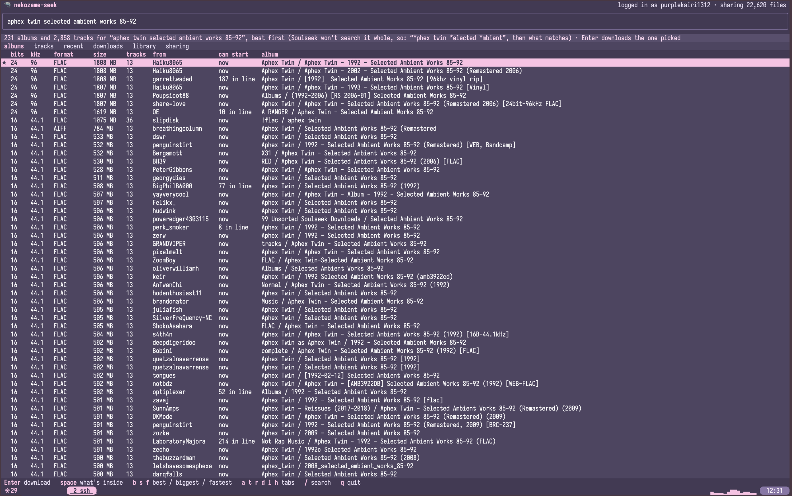

# nekozame-seek

A TUI for Soulseek, meant for servers and high-quality collections. [slskd](https://github.com/slskd/slskd) stays logged in on the server; nekozame-seek is where you search, pick and download, over ssh or anywhere.



- Albums best pick first: lossless, then the highest bit depth, sample rate and size (only the music files counts). Enter downloads the one picked
- Finds what Soulseek blocks searches for (The Beatles, some album titles): it asks again another way (`*eatles`) and keeps what matches what you typed
- Individual tracks on their own tab, `space` shows what's inside an album, and your recent searches are kept
- Puts what you download into your music library for you, with [beets](https://beets.io): it recognises each album, fixes its tags and files it in the right folder ([how](docs/library.md))
- Choose what you share: browse your folders and switch each one on or off
- In [nekozame colours](https://git.sr.ht/~purplekairi1312/nekozame-theme)

## Install

One file: download yours from the [releases](https://github.com/purplekairi1312/nekozame-seek/releases) (GNU/Linux on x86-64 or ARM, macOS on Apple silicon), make it executable and put it in your PATH. Or build it with Rust:

```sh
cargo install --git https://git.sr.ht/~purplekairi1312/nekozame-seek
```

Then, in slskd's `slskd.yml`, give it an API key (any long random text) that can search and download:

```yaml
web:
  authentication:
    api_keys:
      nekozame_seek:
        key: PUT-A-LONG-RANDOM-KEY-HERE
        role: readwrite
```

And tell nekozame-seek about it, in `~/.config/nekozame-seek/config.toml`:

```toml
url = "http://localhost:5030"   # slskd's address
api_key = "PUT-A-LONG-RANDOM-KEY-HERE"
```

To have it put downloads in your library, see [docs/library.md](docs/library.md).

## License

GPL-3.0-or-later.
